<!--
  Antony Luke (AntonyLukeP) — GitHub Profile README
  Vibrant Dark-Slate Engineering Portfolio
-->

  

  

  
  
  
  

---

<table align="center" border="0" cellpadding="0" cellspacing="0" width="100%">
  <tr>
    <td align="center" valign="middle" width="32%">
      
    </td>
    <td valign="top" width="68%">
      <h3>⚡ Backend Engineer Core Profile</h3>
      <pre>
<b>Primary Identity:</b> Antony Luke (AntonyLukeP)
<b>Role:</b> Backend Software Engineer
<b>Core Focus:</b> Java, Spring Boot, REST API Design, PostgreSQL
<b>Engineering Interests:</b> Database Internals, Distributed Systems, Reliability
<b>Current Exploration:</b> Apache Kafka, Concurrency &amp; Fault-Tolerant Design
<b>Approach:</b> <i>"Learning how real-world systems work, fail, and recover."</i>
      </pre>
      <blockquote>
        💡 <b>Engineering Directive:</b> Building complete, end-to-end backend systems—focusing on clean API contracts, transactional data integrity, and predictable behavior beyond the happy path.
      </blockquote>
    </td>
  </tr>
</table>

---

<h2 align="center">🛠️ Technical Stack &amp; Engineering Armory</h2>

<table align="center" border="0" cellpadding="8" cellspacing="0" width="100%">
  <tr>
    <td width="50%" valign="top">
      <h4>💻 Programming Languages</h4>
      

        
        
        
        
        
      

    </td>
    <td width="50%" valign="top">
      <h4>⚙️ Backend &amp; Frontend</h4>
      

        
        
        
        
      

    </td>
  </tr>
  <tr>
    <td width="50%" valign="top">
      <h4>🛢️ Databases &amp; Caching</h4>
      

        
        
        
      

    </td>
    <td width="50%" valign="top">
      <h4>🌐 Distributed Systems &amp; Infra</h4>
      

        
        
        
      

    </td>
  </tr>
  <tr>
    <td colspan="2" align="center" valign="top">
      <h4>🧰 Developer Tools</h4>
      

        
        
        
        
        
        
      

    </td>
  </tr>
</table>

---

<h2 align="center">🧭 Engineering Focus</h2>

<table align="center" border="0" cellpadding="8" cellspacing="0" width="100%">
  <tr>
    <td width="50%" valign="top" style="border-right: 1px solid #30363D; border-bottom: 1px solid #30363D;">
      <h4>🔵 Backend Engineering <code>Hands-on</code></h4>
      

        • <b>Java &amp; Spring Boot:</b> Layered service architecture &amp; clean domain boundaries 
        • <b>REST API Design:</b> Resource-oriented endpoints, validation &amp; error contracts 
        • <b>Auth &amp; Security:</b> Stateless JWT authentication &amp; role-based access control
      

    </td>
    <td width="50%" valign="top" style="border-bottom: 1px solid #30363D; padding-left: 16px;">
      <h4>🟢 Database Engineering <code>Hands-on</code></h4>
      

        • <b>PostgreSQL:</b> Relational schema design, constraints &amp; transactional queries 
        • <b>MongoDB &amp; Redis:</b> Document persistence &amp; low-latency key-value caching 
        • <b>Data Modeling:</b> Normalization, indexing strategies &amp; query predictability
      

    </td>
  </tr>
  <tr>
    <td width="50%" valign="top" style="border-right: 1px solid #30363D;">
      <h4>💠 System Design <code>Exploring &amp; Applying</code></h4>
      

        • <b>Distributed Systems:</b> Service coordination &amp; consistency trade-offs 
        • <b>Scalability &amp; Concurrency:</b> Stateless services, thread safety &amp; load handling 
        • <b>Fault Tolerance:</b> Idempotency, retries, timeouts &amp; graceful degradation
      

    </td>
    <td width="50%" valign="top" style="padding-left: 16px;">
      <h4>🟠 Infrastructure <code>Hands-on &amp; Exploring</code></h4>
      

        • <b>Docker &amp; GitHub Actions:</b> Containerized environments &amp; automated workflows 
        • <b>Apache Kafka:</b> Event-driven messaging &amp; streaming pipelines <i>(exploring)</i> 
        • <b>Observability:</b> Tracing &amp; telemetry fundamentals with OpenTelemetry <i>(exploring)</i>
      

    </td>
  </tr>
</table>

---

<!-- <h2 align="center">🚀 Featured Engineering Projects</h2>

<table align="center" border="0" cellpadding="12" cellspacing="0" width="100%">
  <tr>
    <td valign="top" width="100%" style="background-color: #161B22; border: 1px solid #30363D;">
      <h3>🛒 Rabbit Store — Full-Stack E-Commerce Platform</h3>
      
<i>A full-stack e-commerce application engineered around a production-style Spring Boot backend and React client, supporting product catalog management, cart state, order processing, and stateless JWT authentication.</i>

      <ul>
        <li><b>Stateless Authentication &amp; RBAC:</b> Implemented JWT issuance and request-filter validation to secure customer and administrative API routes without server-side session state.</li>
        <li><b>Transactional Order &amp; Inventory Flow:</b> Modeled relational product, user, and order entities in PostgreSQL to preserve consistency across checkout and order-status transitions.</li>
        <li><b>Predictable Client-Server State:</b> Connected RESTful Spring Boot endpoints to a React + Redux Toolkit frontend for clean synchronization of cart, auth, and catalog state.</li>
      </ul>
      

        
        
        
        
        
        
      

      <!-- PLACEHOLDER: Replace with exact Rabbit Store repository URL (e.g., https://github.com/AntonyLukeP/rabbit-store) -->
      <a href="https://github.com/AntonyLukeP?tab=repositories"><b>Inspect Repository on GitHub →</b></a>
    </td>
  </tr>
</table> -->

---

<h2 align="center">📊 Telemetry &amp; Engineering Metrics</h2>

<table align="center" border="0" cellpadding="5" cellspacing="0" width="100%">
  <tr>
    <td align="center" valign="top" width="50%">
      
    </td>
    <td align="center" valign="top" width="50%">
      
    </td>
  </tr>
  <tr>
    <td align="center" colspan="2" valign="top">
       
      
    </td>
  </tr>
</table>

<!-- 

  

 -->

<!--
  CONTRIBUTION CALENDAR (via .github/workflows/metrics.yml):
  Uncomment the block below after running the "GitHub Metrics" workflow once
  so that assets/metrics/metrics-calendar.svg exists in the repository.

  

-->

---

<h2 align="center">📚 Currently Exploring</h2>

  
  
  
  

---

<h2 align="center">🤝 Initialize Connection</h2>

  
  &nbsp;&nbsp;
  <!-- PLACEHOLDER: Replace YOUR_LINKEDIN_HANDLE with your verified LinkedIn profile slug -->
  
  &nbsp;&nbsp;
  

  <i>"Engineering beyond the happy path. Building for reliability, resilience, and scale."</i>

